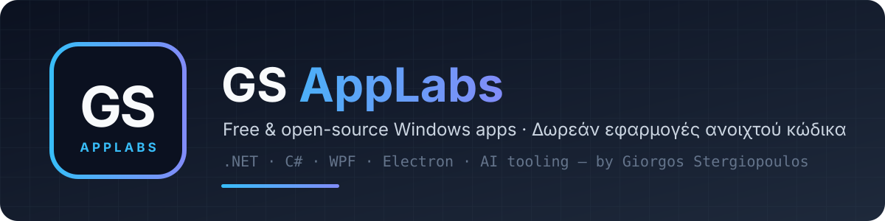

  
  
  
  
  
  
  

---

### 🇬🇧 About
**GS AppLabs** is the home of my projects. I build free, open-source Windows applications — system tools, media software and AI-powered utilities — with a focus on clean UI and real everyday usefulness.

### 🇬🇷 Σχετικά
Το **GS AppLabs** είναι το σπίτι των έργων μου. Αναπτύσσω δωρεάν εφαρμογές ανοιχτού κώδικα για Windows — εργαλεία συστήματος, πολυμέσα και εφαρμογές τεχνητής νοημοσύνης — με έμφαση στο καθαρό UI και στην πρακτική χρησιμότητα.

---

### 🚀 Projects · Έργα

| Project | EN | ΕΛ | Stack |
|---|---|---|---|
| [**Opsis**](https://github.com/gs-applabs/Opsis) | Windows personalization platform with plugins | Πλατφόρμα εξατομίκευσης Windows με plugins | C# |
| [**OpsisMediaSuite**](https://github.com/gs-applabs/OpsisMediaSuite) | Real-time audio enhancer & player: 10-band EQ, LUFS, visualizers, converter, 20 languages | Βελτιωτής & player ήχου σε πραγματικό χρόνο: EQ 10 ζωνών, LUFS, visualizers, μετατροπέας, 20 γλώσσες | Electron · JS |
| [**GearWin**](https://github.com/gs-applabs/GearWin) | Complete PC care: Windows 11 maintenance & optimization suite | Ολοκληρωμένη φροντίδα PC: συντήρηση & βελτιστοποίηση Windows 11 | WPF · .NET 10 |
| [**Kombos**](https://github.com/gs-applabs/Kombos) | Local Windows hub for AI tools, with Claude as the central agent | Τοπικός κόμβος εργαλείων AI για Windows, με τον Claude ως κεντρικό agent | C# · WPF |
| [**OpsisNewsCrawler**](https://github.com/gs-applabs/OpsisNewsCrawler) | Scrolling news & market ticker bar for Windows | Μπάρα ειδήσεων & αγορών για Windows | C# |
| [**san-shmera**](https://github.com/gs-applabs/san-shmera) | Timeline calendar: name days & “on this day” for Greece and Cyprus | Χρονικολόγιο: ονομαστικές εορτές & «σαν σήμερα» για Ελλάδα και Κύπρο | C# · WinForms |

---

  
  

© GS AppLabs · Giorgos Stergiopoulos · Made in Greece 🇬🇷

